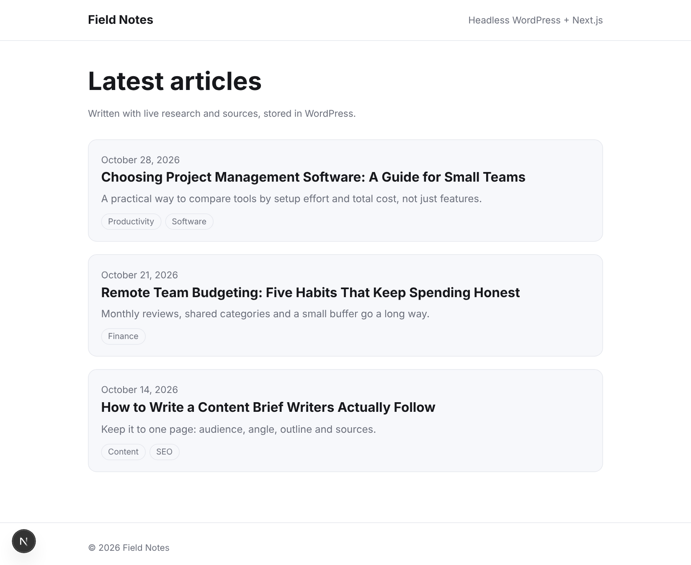
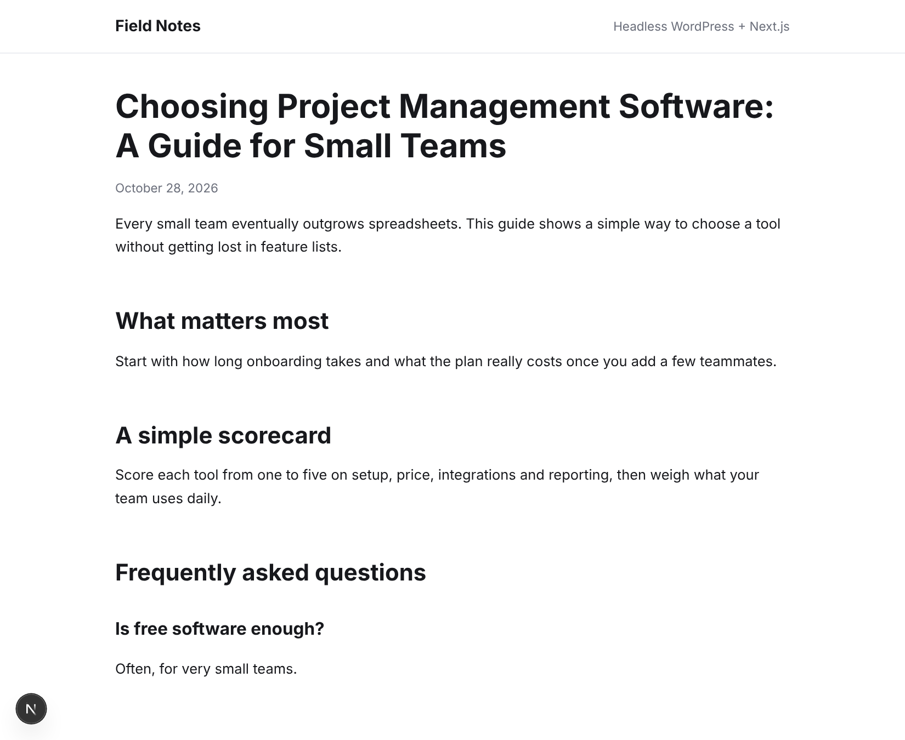

# Next.js AI Blog Starter

  

A fast, SEO-ready **Next.js blog on top of WordPress** that writes its own content. One command generates a researched, sourced article with RapidTextAI and saves it to your WordPress site as a draft (or publishes it). Next.js renders it with static generation, so your readers get a modern, fast front end and your editors keep the WordPress dashboard they know.



*Screenshots were captured in demo mode with sample posts (see [Try it without keys](#try-it-without-keys)).*

## Why use it

- **Content that writes itself, safely.** Generated articles land in WordPress as **drafts** by default, so a human reviews before anything goes live. Add `--publish` when you trust the pipeline.
- **Keep WordPress, lose the slow theme.** WordPress stays your editor and content store. Next.js serves the pages: static HTML, instant navigation, and a good Core Web Vitals baseline.
- **SEO built in.** Per-post titles and descriptions, canonical URLs, Open Graph tags, Article JSON-LD, a sitemap and `robots.txt`, all generated from your posts.
- **Researched, not made up.** Articles come with live web research, an FAQ and cited sources, thanks to the RapidTextAI article engine.
- **Fresh without redeploys.** Pages revalidate every 5 minutes, and generating a post through the API refreshes the site immediately.
- **Small and readable.** Plain JavaScript, three dependencies (`next`, `react`, `react-dom`), no CSS framework. Easy to restyle and extend.

## How it works

```
npm run generate -- "topic"        POST /api/generate
          │                                │
          ▼                                ▼
   RapidTextAI article  ───────▶  WordPress REST API (draft / publish)
   (research, FAQ, sources)                │
                                           ▼
                          Next.js pages (static, revalidated every 5 min)
```



## Requirements

- Node.js 20.9 or newer
- A WordPress site (any host) with the REST API enabled, which is the default
- A RapidTextAI API key (<https://app.rapidtextai.com>)

## Set up

```bash
git clone https://github.com/alisaleem252/nextjs-ai-blog-starter.git
cd nextjs-ai-blog-starter
npm install
cp .env.example .env.local
```

Edit `.env.local`:

| Variable | What it is |
|---|---|
| `RAPIDTEXTAI_API_KEY` | Your RapidTextAI key |
| `WP_URL` | Your WordPress site URL, no trailing slash |
| `WP_USER` / `WP_APP_PASSWORD` | A WordPress user and an [Application Password](https://wordpress.org/documentation/article/application-passwords/) (WP Admin → Users → Profile → Application Passwords) |
| `NEXT_PUBLIC_SITE_NAME` / `NEXT_PUBLIC_SITE_URL` | Your blog's name and public URL (used for SEO) |
| `GENERATE_SECRET` | Optional. Enables `POST /api/generate`; send it as the `x-generate-secret` header |

Then:

```bash
npm run dev          # http://localhost:3000
```

## Generate articles

```bash
# Saves a DRAFT in WordPress (review it in WP Admin, then publish)
npm run generate -- "project management software for small teams"

# Publish immediately, with options
npm run generate -- "remote team budgeting" --publish -k "team budget" -w 1800 -t "friendly, practical" --type guide
```

Each article takes 1-3 minutes and costs 6 RapidTextAI request units.

**Over HTTP** (for automations, cron jobs, Zapier or n8n):

```bash
curl -X POST https://your-site.com/api/generate \
  -H "x-generate-secret: $GENERATE_SECRET" -H "content-type: application/json" \
  -d '{"topic": "standing desks buying guide", "publish": false}'
```

The endpoint is disabled unless `GENERATE_SECRET` is set. Allowed fields: `topic`, `keyword`, `word_count`, `tone`, `language`, `audience`, `article_type`, `cta`, `brand_id`, `model`, `outline_hint`, plus `publish` (default `false`).

## Deploy

Deploys to Vercel or any Node host: set the same environment variables, then `npm run build && npm start`. The site builds even if WordPress is temporarily unreachable (it shows an empty list and fills in on the next revalidation).

> **Long-running requests:** `POST /api/generate` can take up to 3 minutes. Vercel's function time limit depends on your plan, so on plans that cap it lower, run `npm run generate` from your machine or a scheduled job instead.

## Try it without keys

```bash
npm install
npm run demo
```

Starts the site against a fake WordPress and a fake RapidTextAI API with sample content. No accounts, keys or units needed. This is how the screenshots were made, so the posts shown are examples, not real articles.

## Customize

- Styling: `app/globals.css` (plain CSS with automatic dark mode)
- Layout and header: `app/layout.js`
- Post template and SEO metadata: `app/blog/[slug]/page.js`
- What gets sent to WordPress: `lib/publish.js` and `lib/wordpress.js`
- Revalidation time: the `revalidate` value in the page files and `lib/wordpress.js`

## Good to know

- **Drafts first.** Nothing is published unless you pass `--publish` or `"publish": true`.
- **Review generated content.** Articles are researched and cited, but a human should still check facts before publishing.
- **One generation at a time.** RapidTextAI runs one job per account at once.
- **Secrets stay on the server.** Keys are only read in server code and scripts, never sent to the browser.
- **Featured images** come from WordPress. Set them in WP Admin and the home page shows them.

## Development

```bash
npm test       # offline tests with fake WordPress and RapidTextAI servers
```

## License

No license has been chosen yet; add one before accepting contributions.
